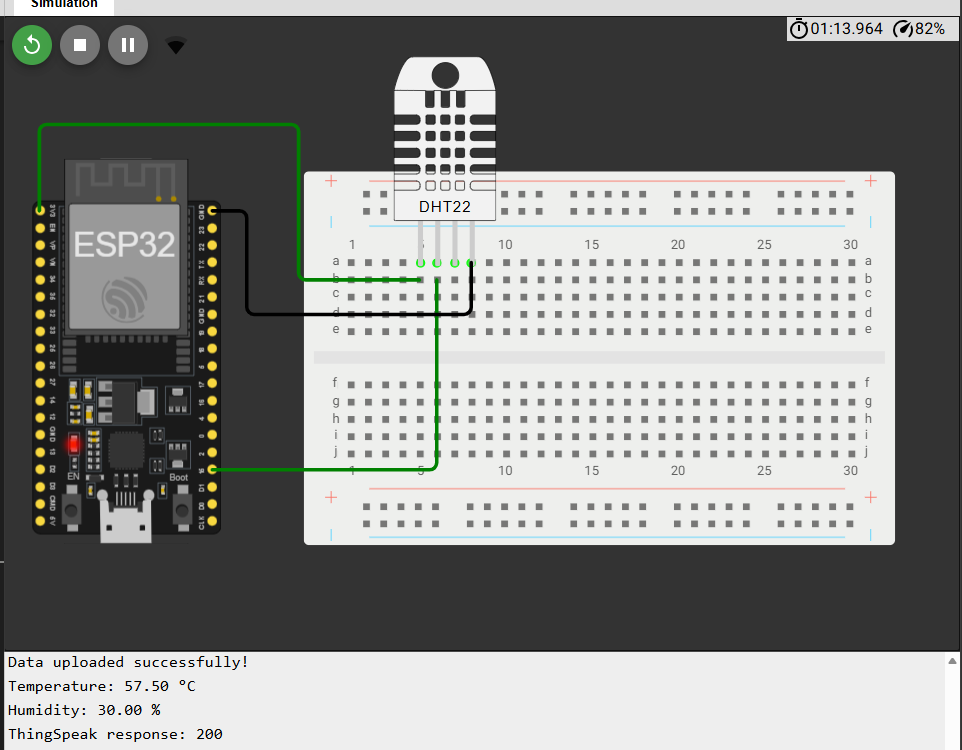
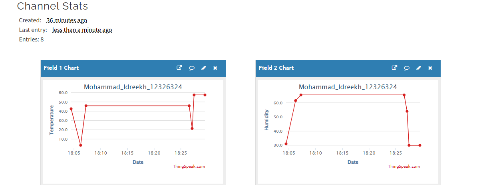

# Lab 1: ESP32 Temperature and Humidity Monitoring

## Project Description

This project uses an ESP32 and a DHT22 sensor to measure temperature and humidity. The readings are sent to ThingSpeak over Wi-Fi for online monitoring.

## Student Information

- **Full Name:** Mohammad Idreekh
- **University ID:** 12326324

## Wokwi Simulation

[Open the Wokwi Project](https://wokwi.com/projects/478950406594929665)

## ThingSpeak Channel

[View the ThingSpeak Channel](https://thingspeak.mathworks.com/channels/3551713)

## Screenshots

### Wokwi Simulation

### ThingSpeak Channel

